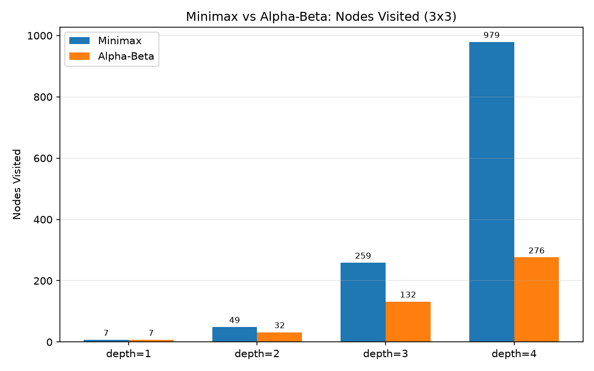
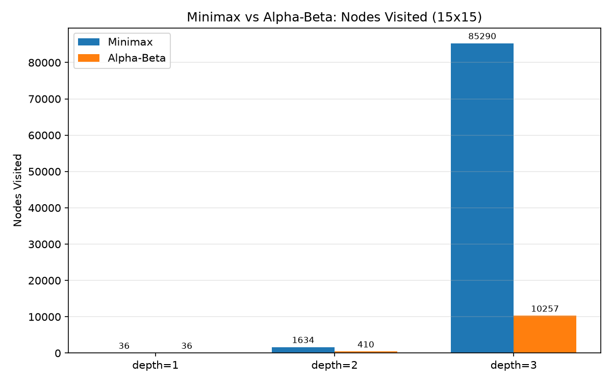
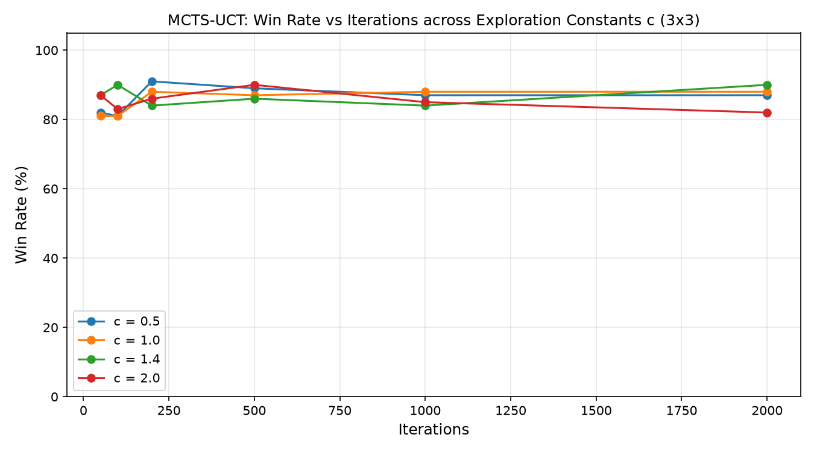
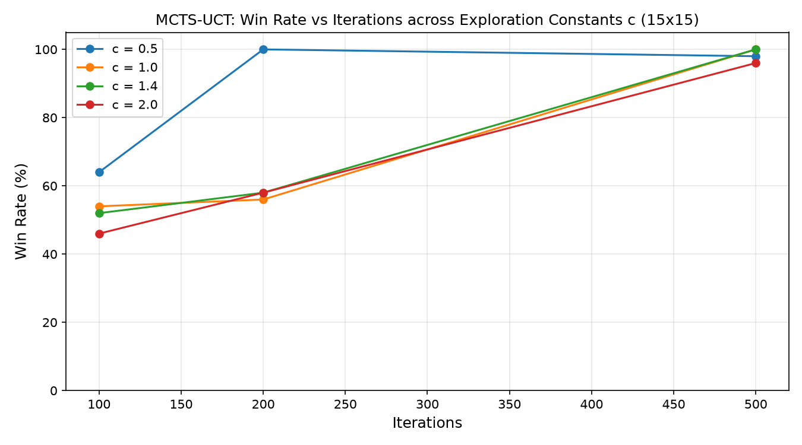
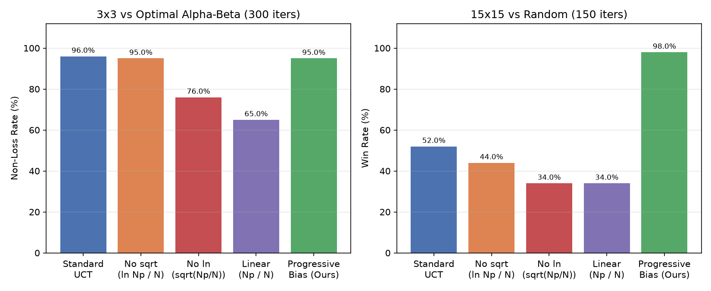

## Abstract (≤ 200 words)

We present an implementation and empirical comparison of two classical game-tree search algorithms—Minimax with Alpha-Beta pruning and Monte Carlo Tree Search with Upper Confidence Bound applied to Trees (MCTS-UCT)—on both classic 3×3 Tic-Tac-Toe and 15×15 five-in-a-row (Gomoku). Alpha-Beta pruning reduces the visited node count of Minimax by 71.8% at depth 4 on 3×3 and by 88.0% at depth 3 on 15×15 without altering the chosen move. On 3×3 Tic-Tac-Toe, MCTS-UCT with ≥ 1000 iterations achieves 0 losses across 50 alternating-first-move games against both a random agent and an optimal depth-9 Alpha-Beta opponent. Across exploration constants c ∈ {0.5, 1.0, 1.4, 2.0}, c = 0.5 converges fastest under tight budgets on 15×15 (100% win rate at 200 iterations), while c ∈ {1.0, 1.4} reach 100% (50/50) at 500 iterations. Replacing random rollout with a lightweight one-step tactical heuristic rollout improves win rate by +6.0% on 3×3 (84.0% → 90.0%) and +16.0% on 15×15 (76.0% → 92.0%), illustrating the principle behind value and policy networks in modern systems such as AlphaGo. We also derive UCT from Multi-Armed Bandit regret bounds and explain why final move selection uses visit count N rather than empirical win rate W/N.

**Keywords:** Minimax, Alpha-Beta Pruning, MCTS, UCT, Multi-Armed Bandit, Tic-Tac-Toe, Gomoku

---

## 1. Introduction

Game-tree search is a cornerstone of artificial intelligence research, with applications ranging from board games to automated planning and scheduling. Tic-Tac-Toe—despite its simple rules—serves as an ideal benchmark for comparing exact deterministic search (Minimax with Alpha-Beta pruning) and stochastic anytime search (MCTS-UCT), especially when scaled from 3×3 (three-in-a-row) to 15×15 (five-in-a-row / Gomoku), where exhaustive search becomes computationally intractable.

**Research Questions (RQ):**
- **RQ1:** How much does Alpha-Beta pruning reduce the search tree compared to plain Minimax on 3×3 and 15×15 boards?
- **RQ2:** How does the UCT exploration constant c ∈ {0.5, 1.0, 1.4, 2.0} affect win rate across iteration budgets?
- **RQ3:** Does MCTS-UCT never lose on 3×3 Tic-Tac-Toe, and at what iteration threshold does this hold?
- **RQ4:** How much does a lightweight heuristic rollout improve MCTS over random rollout, and what is the runtime trade-off?
- **RQ5:** Why should the final move be selected by visit count N rather than empirical win rate W/N?
- **RQ6 (Bonus):** How do UCT formula ablations (removing `√`, `ln`, or both) and a Progressive Bias improvement affect search performance?

---

## 2. Problem Formulation

The game is modelled as a two-player, zero-sum, deterministic, perfect-information game:
- **State** s: an n × n grid with cells ∈ {X (+1), O (−1), ∅ (0)}, where X moves first.
- **Action** a: placing the current player's marker on an empty cell. To keep search tractable on 15×15, `get_legal_moves()` restricts candidates to empty cells within Chebyshev distance `radius = 2` of existing stones (and forces the center cell `(n//2, n//2)` on an empty board). Radius 2 preserves one-gap tactical threats such as `_ O _ O _`.
- **Terminal test**: `win_len` consecutive markers horizontally, vertically, or diagonally (3 on 3×3; 5 on 15×15), or a full board (draw).
- **Utility**:
  - For Minimax/Alpha-Beta: `+1,000,000` (win), `−1,000,000` (loss), `0` (draw), or heuristic score `eval(s, p)` at depth cutoff.
  - For MCTS-UCT: `1.0` (win), `0.5` (draw or truncated rollout), `0.0` (loss), bounded in `[0, 1]` as required by UCB1.

---

## 3. Methods

### 3.1 Minimax with Alpha-Beta Pruning and Evaluation Function

Minimax performs depth-first search up to `max_depth`, assuming both players play optimally:

```
minimax(s, d, maximising):
  if terminal(s) or d = 0: return eval(s, me)
  if maximising: return max over a of minimax(result(s, a), d - 1, false)
  else:          return min over a of minimax(result(s, a), d - 1, true)
```

Alpha-Beta maintains two bounds—α (best guaranteed score for MAX) and β (best guaranteed score for MIN)—and prunes any subtree once α ≥ β. In the best move ordering, time complexity drops from O(b^d) to O(b^(d/2)), effectively doubling searchable depth.

**Heuristic Evaluation Function (`evaluate`):**
At non-terminal depth cutoffs, the board is scanned along all four directions (horizontal, vertical, main diagonal, anti-diagonal). For each contiguous run of length `L` belonging to player `p`, empty spaces on both sides (`space_left`, `space_right`) are counted. If `L + space_left + space_right < win_len`, the line is dead and scores `0`. Otherwise, `open_ends ∈ {1, 2}` counts adjacent empty cells (capped at `1` if total available space equals `win_len`), and the pattern is scored non-linearly:

| Length | Open Ends | Score | Rationale |
|:---:|:---:|---:|---|
| 5 | 1 or 2 | 100,000 | Winning line |
| 4 | 2 | 50,000 | Unstoppable double threat |
| 4 | 1 | 5,000 | Immediate threat, blockable in 1 move |
| 3 | 2 | 2,000 | Strong open three (10× single-open) |
| 3 | 1 | 200 | Closed three |
| 2 | 2 | 100 | Developing open two |
| 2 | 1 | 10 | Closed two |
| 1 | 2 / 1 | 5 / 1 | Minor positional bias |

The final heuristic value is `total_score(me) − total_score(opponent)`. Exponential scaling forces Minimax to prioritize blocking/creating open fours over accumulating minor twos, while the 10× multiplier for two open ends reflects that an opponent can only block one side per turn.

### 3.2 MCTS + UCT and Mathematical Foundation

MCTS incrementally builds an asymmetric search tree over `iterations` cycles of four phases:
1. **Selection**: starting at the root, descend via `best_child(c)` maximizing UCT until reaching a node that is either terminal or not fully expanded.
2. **Expansion**: pop one untried legal move and attach a new child node.
3. **Simulation (Rollout)**: play from the new node using `rollout_fn` and obtain outcome `r ∈ {0.0, 0.5, 1.0}` from the perspective of `node.player` (the player who just moved to reach `node`).
4. **Backpropagation**: walk up to the root, incrementing `N += 1`, adding `W += r` (except at the root which has no incoming move), and flipping perspective `r ← 1.0 − r` at each parent step because parent and child represent opposing players.

The UCT selection formula for child `i` is:

$$UCT_i = \underbrace{\frac{W_i}{N_i}}_{\text{Exploitation}} + c\,\underbrace{\sqrt{\frac{\ln N_{\mathrm{parent}}}{N_i}}}_{\text{Exploration}}$$

Unvisited children (`N_i = 0`) are assigned `+∞` so every legal move is tried at least once before UCT comparison begins.

**Mathematical Foundation (Multi-Armed Bandit & UCB1):**
At each internal node, choosing among `K` legal moves is an instance of the stochastic **Multi-Armed Bandit (MAB)** problem: each child `i` is an arm with unknown true expected reward `μ_i ∈ [0, 1]`. Auer et al. (2002) introduced the **UCB1** policy, which selects the arm maximizing the upper confidence bound of `μ_i`.

The square-root and logarithmic terms arise directly from **Hoeffding's inequality**. For `N_i` i.i.d. samples `X_1, ..., X_{N_i} ∈ [0, 1]` with empirical mean `X̄_i = W_i / N_i` and true mean `μ_i`:

$$P\left(\bar{X}_i - \mu_i \ge \epsilon\right) \le e^{-2 N_i \epsilon^2}, \qquad P\left(\mu_i - \bar{X}_i \ge \epsilon\right) \le e^{-2 N_i \epsilon^2}$$

Setting the tail probability bound to `N_parent^{-4}` (the smallest integer exponent ensuring that summing over all `≤ t^2` visit-count pairs `(s, s_i)` at step `t` yields a convergent series `∑ t^2 · t^{-4} = ∑ t^{-2} = π^2/6 < ∞`, keeping the error term `O(1)`) gives:

$$e^{-2 N_i \epsilon^2} = N_{\mathrm{parent}}^{-4} \implies \epsilon = \sqrt{\frac{2 \ln N_{\mathrm{parent}}}{N_i}}$$

Thus, with high probability, the true value `μ_i` lies below `W_i/N_i + √(2 ln N_parent / N_i)`. Choosing the arm with the highest upper bound guarantees **optimism in the face of uncertainty**:
- The `ln N_parent` numerator grows sub-linearly, ensuring neglected arms are revisited infinitely often as `N_parent → ∞`, yet at a vanishing rate so optimal arms dominate.
- The `1 / √N_i` factor shrinks the confidence interval as more samples are collected for arm `i`.

Auer et al. proved that UCB1 achieves logarithmic cumulative regret:

$$R(N) \le \sum_{i:\,\Delta_i > 0} \frac{8 \ln N}{\Delta_i} + O(1), \qquad \Delta_i = \mu^* - \mu_i$$

which matches the Lai–Robbins asymptotic lower bound `Ω(ln N)` up to constant factors. Kocsis & Szepesvári (2006) extended UCB1 recursively to game trees (**UCT**), proving convergence to the minimax-optimal move as `N → ∞`. In practice, the theoretical constant `√2 ≈ 1.414` assumes stationary i.i.d. rewards in `[0, 1]`; in game trees, rollout rewards are non-stationary (changing as deeper subtrees expand) and domain-dependent, motivating empirical tuning of `c`.

### 3.3 Rollout Strategies

- **Random rollout (`random_rollout`)**: selects uniformly random legal moves up to `MAX_ROLLOUT_STEPS = 30` steps. On 3×3, games finish within ≤ 9 moves so truncation never triggers. On 15×15, random play rarely forms five-in-a-row within 30 moves; truncated simulations return `0.5` (draw/undecided) to keep runtime bounded and avoid biasing outcomes by parity.
- **Heuristic rollout (`heuristic_rollout`)**: at each simulation step (also capped at `MAX_ROLLOUT_STEPS = 30`), checks all legal moves in order: (1) play an immediate winning move if one exists; (2) otherwise block an opponent's immediate winning move; (3) otherwise pick uniformly at random. This one-ply tactical filter approximates a lightweight policy/value prior and is the conceptual precursor to the neural policy and value networks in AlphaGo [Silver et al., 2016].

### 3.4 UCT Variants and Progressive Bias Improvement

To empirically validate the necessity of both `√` and `ln` in UCT and improve low-budget performance on 15×15, we evaluate four ablations alongside an improved formula:
- **Standard UCT**: `W_i/N_i + c * sqrt(ln(N_p) / N_i)`
- **No-sqrt**: `W_i/N_i + c * (ln(N_p) / N_i)`
- **No-ln**: `W_i/N_i + c * sqrt(N_p / N_i)`
- **Linear**: `W_i/N_i + c * (N_p / N_i)`
- **Progressive Bias (Improved UCT)**:

$$UCT_{\mathrm{PB}}(i) = \frac{W_i}{N_i} + c\sqrt{\frac{\ln N_{\mathrm{parent}}}{N_i}} + \frac{H_i}{N_i + 1}, \qquad H_i = \frac{1 + \tanh(\mathrm{eval}(s_i, p_i) / 5000)}{2} \in (0, 1)$$

where `H_i` is computed once per node via `evaluate()` and decays as `1 / (N_i + 1) → 0` as visits grow, preserving UCT's asymptotic optimality while guiding early exploration on large boards.

---

## 4. Experimental Setup

All experiments were executed in Python 3.14 (NumPy, Matplotlib) on a 12-core CPU using parallel game workers (`ProcessPoolExecutor`) with deterministic per-game seeds and alternating first-player assignment (`X` on even games, `O` on odd games) to eliminate first-move bias.

| Experiment | Board | Opponent | Config | Games / Config | Metrics |
|---|---|---|---|---|---|
| Minimax vs Alpha-Beta | 3×3 & 15×15 | Self (fixed test states) | depth ∈ {1..4} (3×3), {1..3} (15×15) | 1 state | Nodes visited, reduction (%) |
| MCTS `c` × iterations | 3×3 | Random agent | c ∈ {0.5, 1.0, 1.4, 2.0}, iters ∈ {50..2000} | 100 | W/D/L, win rate (%), ms/move |
| MCTS `c` × iterations | 15×15 | Random agent | c ∈ {0.5, 1.0, 1.4, 2.0}, iters ∈ {100, 200, 500} | 50 | W/D/L, win rate (%), ms/move |
| Never-lose verification | 3×3 | Alpha-Beta (depth 9) & Random | c ∈ {1.0, 1.414}, iters ∈ {100, 500, 1000, 2000} | 50 | Wins, draws, losses |
| Rollout comparison | 3×3 & 15×15 | Random agent | c = √2, iters = 500 (3×3) / 200 (15×15) | 100 (3×3) / 50 (15×15) | W/D/L, win rate (%), ms/move |
| UCT variants & PB | 3×3 & 15×15 | AB (d=9) & Random | c = 1.0, iters = 300/200 (3×3), 150 (15×15) | 100 (3×3) / 50 (15×15) | Win/Non-loss (%), ms/move |

---

## 5. Results

### 5.1 Minimax vs Alpha-Beta: Node Count

| Board | Depth | Minimax nodes | Alpha-Beta nodes | Reduction |
|---|---:|---:|---:|---:|
| 3×3 | 1 | 7 | 7 | 0.0% |
| 3×3 | 2 | 49 | 32 | 34.7% |
| 3×3 | 3 | 259 | 132 | 49.0% |
| 3×3 | 4 | 979 | 276 | **71.8%** |
| 15×15 | 1 | 36 | 36 | 0.0% |
| 15×15 | 2 | 1,634 | 410 | 74.9% |
| 15×15 | 3 | 85,290 | 10,257 | **88.0%** |




### 5.2 MCTS Never-Lose Verification on 3×3

Against an optimal depth-9 Alpha-Beta opponent (which searches the entire 3×3 game tree) and a random baseline (50 alternating games per configuration):

| Opponent | c | Iterations | Wins | Draws | Losses |
|---|---:|---:|---:|---:|---:|
| Alpha-Beta (depth 9) | 1.0 | 100 | 0 | 39 | 11 |
| Alpha-Beta (depth 9) | 1.0 | 500 | 0 | 48 | 2 |
| Alpha-Beta (depth 9) | 1.0 | 1000 | 0 | 50 | **0** |
| Alpha-Beta (depth 9) | 1.0 | 2000 | 0 | 50 | **0** |
| Alpha-Beta (depth 9) | 1.414 | 100 | 0 | 41 | 9 |
| Alpha-Beta (depth 9) | 1.414 | 500 | 0 | 48 | 2 |
| Alpha-Beta (depth 9) | 1.414 | 1000 | 0 | 50 | **0** |
| Alpha-Beta (depth 9) | 1.414 | 2000 | 0 | 50 | **0** |
| Random | 1.0 | 100 | 46 | 2 | 2 |
| Random | 1.0 | 500 | 41 | 9 | **0** |
| Random | 1.0 | 1000 | 40 | 10 | **0** |
| Random | 1.0 | 2000 | 44 | 6 | **0** |
| Random | 1.414 | 100 | 44 | 2 | 4 |
| Random | 1.414 | 500 | 41 | 9 | **0** |
| Random | 1.414 | 1000 | 41 | 9 | **0** |
| Random | 1.414 | 2000 | 44 | 6 | **0** |

### 5.3 Win Rate vs Iterations (3×3 and 15×15)

**3×3 Board (100 games per configuration, vs Random):**

| c | 50 iters | 100 iters | 200 iters | 500 iters | 1000 iters | 2000 iters |
|---:|---:|---:|---:|---:|---:|---:|
| 0.5 | 82.0% (82/10/8) | 81.0% (81/18/1) | 91.0% (91/8/1) | 89.0% (89/9/2) | 87.0% (87/13/0) | 87.0% (87/13/0) |
| 1.0 | 81.0% (81/13/6) | 81.0% (81/17/2) | 88.0% (88/10/2) | 87.0% (87/13/0) | 88.0% (88/12/0) | 88.0% (88/12/0) |
| 1.4 | 87.0% (87/8/5) | 90.0% (90/8/2) | 84.0% (84/15/1) | 86.0% (86/14/0) | 84.0% (84/16/0) | 90.0% (90/10/0) |
| 2.0 | 87.0% (87/7/6) | 83.0% (83/10/7) | 86.0% (86/13/1) | 90.0% (90/10/0) | 85.0% (85/15/0) | 82.0% (82/18/0) |



**15×15 Board (50 games per configuration, vs Random):**

| c | 100 iters | 200 iters | 500 iters | Avg ms/move (500 iters) |
|---:|---:|---:|---:|---:|
| 0.5 | **64.0%** (32/0/18) | **100.0%** (50/0/0) | 98.0% (49/0/1) | 5,229 ms |
| 1.0 | 54.0% (27/0/23) | 56.0% (28/0/22) | **100.0%** (50/0/0) | 5,159 ms |
| 1.4 | 52.0% (26/0/24) | 58.0% (29/0/21) | **100.0%** (50/0/0) | 5,118 ms |
| 2.0 | 46.0% (23/0/27) | 58.0% (29/0/21) | 96.0% (48/0/2) | 5,674 ms |



### 5.4 Root Node Statistics (W, N, W/N)

Snapshot after `iterations = 1000`, `c = 1.0` on the 3×3 test state (X at `(1,1)`, O at `(0,0)`, X to move) and 15×15 opening state (`(7,7), (7,8), (8,7), (6,7)`):

**3×3 Test State:**

| Move | W | N | W/N |
|---|---:|---:|---:|
| (0, 1) | 242.5 | 299 | 0.811 |
| (1, 0) | 195.0 | 246 | 0.793 |
| (2, 0) | 87.0 | 121 | 0.719 |
| (0, 2) | 80.0 | 112 | 0.714 |
| (2, 1) | 56.0 | 83 | 0.675 |
| (1, 2) | 50.5 | 77 | 0.656 |
| (2, 2) | 39.0 | 62 | 0.629 |

**15×15 Opening State (top 8 moves):**

| Move | W | N | W/N |
|---|---:|---:|---:|
| (5, 9) | 16.5 | 31 | 0.532 |
| (10, 7) | 15.5 | 30 | 0.517 |
| (5, 8) | 15.5 | 30 | 0.517 |
| (10, 5) | 15.5 | 30 | 0.517 |
| (4, 8) | 15.0 | 29 | 0.517 |
| (5, 6) | 15.0 | 29 | 0.517 |
| (8, 6) | 15.0 | 29 | 0.517 |
| (9, 8) | 14.5 | 29 | 0.500 |

### 5.5 Random Rollout vs Heuristic Rollout

| Board | Iterations | Games | Rollout | Wins | Draws | Losses | Win rate | Avg ms/move |
|---|---:|---:|---|---:|---:|---:|---:|---:|
| 3×3 | 500 | 100 | Random | 84 | 16 | 0 | 84.0% | 52.2 ms |
| 3×3 | 500 | 100 | Heuristic | 90 | 10 | 0 | **90.0%** (+6.0%) | 51.2 ms |
| 15×15 | 200 | 50 | Random | 38 | 0 | 12 | 76.0% | 3,647 ms |
| 15×15 | 200 | 50 | Heuristic | 46 | 0 | 4 | **92.0%** (+16.0%) | 5,553 ms |

### 5.6 UCT Formula Variants and Progressive Bias

| Variant | 3×3 vs AB d=9 (300 iters, Non-Loss) | 3×3 vs Random (200 iters, Win / Non-Loss) | 15×15 vs Random (150 iters, Win / ms) |
|---|---:|---:|---:|
| Standard UCT | **96.0%** (0/96/4) | 88.0% / 98.0% | 52.0% (26/0/24) / 2,709 ms |
| No-sqrt (`ln N_p / N`) | 95.0% (0/95/5) | 84.0% / 99.0% | 44.0% (22/0/28) / 2,629 ms |
| No-ln (`√(N_p / N)`) | 76.0% (0/76/24) | 88.0% / 97.0% | 34.0% (17/0/33) / 3,037 ms |
| Linear (`N_p / N`) | 65.0% (0/65/35) | 83.0% / 93.0% | 34.0% (17/0/33) / 3,066 ms |
| **Progressive Bias (Ours)** | 95.0% (0/95/5) | **88.0% / 100.0%** | **98.0% (49/0/1) / 2,390 ms** |



---

## 6. Discussion

**RQ1 (Alpha-Beta Pruning Efficiency):** Alpha-Beta reduced visited nodes by 71.8% at depth 4 on 3×3 (979 → 276) and by 88.0% at depth 3 on 15×15 (85,290 → 10,257). Pruning gains grow sharply with branching factor and depth, confirming why plain Minimax is unusable beyond depth 2 on 15×15 Gomoku.

**RQ2 (Effect of Exploration Constant c):** On 3×3, all four values of `c` reach 0 losses against random play once `iterations ≥ 500`, with win rates plateauing around 84–90% (the remaining 10–16% are draws when MCTS plays second as O). On 15×15, the exploration–exploitation trade-off is pronounced at low budgets: `c = 0.5` converges fastest (64% at 100 iterations, 100% at 200 iterations), whereas larger `c` values spend early budget exploring wide neighborhoods (46–54% at 100 iterations). Once `iterations = 500`, all four constants converge to 96–100%, with `c = 1.0` and `c = 1.4` reaching 100% (50/50). Thus, smaller `c` (0.5) is preferable under tight iteration budgets on large boards, while `c ∈ [1.0, 1.4]` is optimal when sufficient budget is available.

**RQ3 (Never-Lose Property on 3×3):** Against an optimal depth-9 Alpha-Beta player, MCTS still loses occasionally at low budgets (11/50 losses at 100 iterations, 2/50 at 500 iterations for `c = 1.0`) because shallow trees miss forced forks. From `iterations ≥ 1000` onward, MCTS achieves **0 losses out of 50 games** (50 draws) for both `c = 1.0` and `c = 1.414`, empirically confirming the theoretical convergence of UCT on 3×3 Tic-Tac-Toe.

**RQ4 (Heuristic Rollout vs Value Networks):** Replacing random rollout with a one-ply win/block heuristic improved win rate by **+6.0%** on 3×3 (84.0% → 90.0% at 500 iterations) and **+16.0%** on 15×15 (76.0% → 92.0% at 200 iterations), while increasing per-move latency on 15×15 by only ~1.52× (3,647 ms → 5,553 ms) thanks to in-place win/block checks without board cloning. Even a shallow tactical filter substantially reduces simulation noise on large boards. This mirrors the evolution from classical MCTS to AlphaGo/AlphaZero [Silver et al., 2016], where learned policy and value networks replace noisy rollouts with direct position evaluation and move priors.

**RQ5 (Selecting by N vs W/N):** At the end of search, `get_move()` selects `most_visited_child()` (highest `N`) rather than highest `W/N`. A rarely visited child can exhibit an inflated `W/N` (e.g., 1.0 from 1–2 lucky rollouts) due to high sampling variance. Because UCT allocates visits asymptotically in proportion to arm quality, the most-visited child has both the tightest confidence bound and the lowest-variance value estimate.

**RQ6 (UCT Ablations & Progressive Bias):** Removing `ln` (`no_ln`) or both `√` and `ln` (`linear`) causes the exploration term to grow polynomially with `N_parent`, preventing UCT from concentrating visits on strong moves: non-loss rate against optimal Alpha-Beta on 3×3 drops from 96.0% to 76.0% and 65.0%, and 15×15 win rate drops from 52.0% to 34.0%. Removing only `√` (`no_sqrt`) over-penalizes early visits and lowers 15×15 win rate to 44.0%. Conversely, adding Progressive Bias (`H_i / (N_i + 1)`) boosts 15×15 win rate at 150 iterations from **52.0% to 98.0% (+46.0%)** while reducing average move time (2,709 ms → 2,390 ms) because games finish in fewer moves.

**Limitations:**
1. On 15×15, capping rollouts at `MAX_ROLLOUT_STEPS = 30` keeps runtime practical, but most early-game rollouts terminate undecided (`0.5`), flattening root `W/N` values around `0.50–0.53` (Section 5.4). Evaluating truncated rollouts with `evaluate()` instead of returning `0.5` would provide stronger signal.
2. `MCTSAgent` rebuilds the search tree from scratch on every move (no tree reuse) and `Board.get_legal_moves()` recomputes the radius-2 neighborhood from `move_history` on every call.
3. Alpha-Beta depth 3 on 15×15 lacks move ordering and double-threat detection in `evaluate()`, making it vulnerable to multi-move forks.

---

## 7. Conclusion

We implemented and evaluated Minimax with Alpha-Beta pruning and MCTS-UCT on 3×3 and 15×15 Tic-Tac-Toe. Alpha-Beta prunes 71.8% of nodes on 3×3 (depth 4) and 88.0% on 15×15 (depth 3). On 3×3, MCTS-UCT reaches 0 losses against both random play (≥ 500 iterations) and optimal depth-9 Alpha-Beta (≥ 1000 iterations). On 15×15, `c = 0.5` converges fastest at low budgets (100% at 200 iterations), while `c ∈ {1.0, 1.4}` achieve 100% (50/50) at 500 iterations. Finally, a lightweight one-ply heuristic rollout boosts win rate by +6.0% on 3×3 and +16.0% on 15×15, demonstrating the core intuition behind neural value/policy networks in modern game AI.

---

## References

1. P. Auer, N. Cesa-Bianchi, and P. Fischer, "Finite-time analysis of the multiarmed bandit problem," *Machine Learning*, vol. 47, no. 2–3, pp. 235–256, 2002.
2. L. Kocsis and C. Szepesvári, "Bandit based Monte-Carlo planning," in *Proc. ECML*, 2006, pp. 282–293.
3. R. Coulom, "Efficient selectivity and backup operators in Monte-Carlo tree search," in *Proc. ICCG*, 2006, pp. 72–83.
4. D. Silver et al., "Mastering the game of Go with deep neural networks and tree search," *Nature*, vol. 529, pp. 484–489, 2016.
5. S. Russell and P. Norvig, *Artificial Intelligence: A Modern Approach*, 4th ed. Pearson, 2020.
